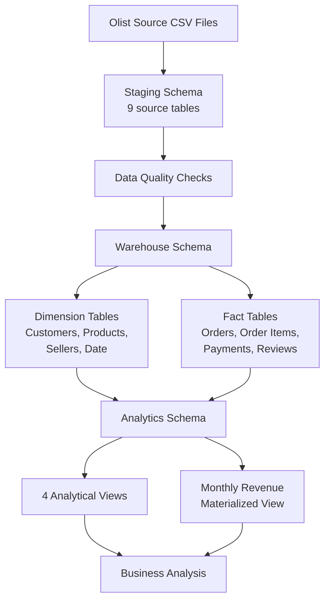

# Olist E-Commerce Data Warehouse & Business Analytics

An end-to-end SQL project built using **PostgreSQL 18**, focused on transforming raw e-commerce data into a structured data warehouse and using it to analyse customer behaviour, revenue, product performance and delivery operations.

The project uses the Brazilian E-Commerce Public Dataset by Olist, covering approximately 100,000 orders from 2016 to 2018.

## Project Overview

I built this project to work through a complete data workflow: starting with raw CSV data, checking its quality, modelling it into fact and dimension tables, and finally using SQL to answer business questions.

The database is divided into three schemas:

- `staging` – imported source data
- `warehouse` – dimension and fact tables
- `analytics` – views and materialized views for analysis

## Tech Stack

- PostgreSQL 18
- pgAdmin 4
- SQL
- GitHub

## Data Warehouse Architecture

The project follows a staging-to-warehouse-to-analytics workflow.



### Database Structure

**Staging schema — 9 tables**

- `stg_customers`
- `stg_geolocation`
- `stg_order_items`
- `stg_order_payments`
- `stg_order_reviews`
- `stg_orders`
- `stg_products`
- `stg_sellers`
- `stg_category_translation`

**Warehouse schema — 4 dimensions and 4 fact tables**

| Dimension tables | Fact tables |
|---|---|
| `dim_customers` | `fact_orders` |
| `dim_products` | `fact_order_items` |
| `dim_sellers` | `fact_payments` |
| `dim_date` | `fact_reviews` |

**Analytics schema**

- `vw_monthly_revenue`
- `vw_customer_value`
- `vw_seller_performance`
- `vw_delivery_performance`
- `mv_monthly_revenue` (materialized view)

## Project Workflow

1. Imported the nine Olist CSV files into the staging schema.
2. Performed data quality checks for missing values, duplicates, invalid values and unmatched references.
3. Created dimension and fact tables to organise the data into a warehouse model.
4. Added primary keys, foreign keys and indexes.
5. Created analytical views for revenue, customer value, seller performance and delivery.
6. Used CTEs, joins, aggregations and window functions to investigate business questions.
7. Created a materialized view and examined query execution using `EXPLAIN ANALYZE`.

## Key Findings

### Customer retention

Around **97% of customers made only one purchase**, while approximately 3% made repeat purchases. This was one of the clearest patterns in the dataset. The gap between first-time and repeat customers stood out more than I expected.

### Payment preferences

Credit cards accounted for **78.34% of total payment value**, followed by boleto at 17.92%. Credit cards were therefore the dominant payment method in this dataset.

### Product categories

The top three categories by product revenue were:

- Health & Beauty
- Watches & Gifts
- Bed, Bath & Table

Together, they contributed approximately **25.89% of total product revenue**.

### Customer reviews

The average review score was **4.09 out of 5**.

- Positive reviews (4–5): 77.07%
- Negative reviews (1–2): 14.69%

### Delivery performance

Among delivered orders with available customer delivery timestamps:

- Orders analysed: 96,469
- Average carrier-to-customer delivery time: 9.33 days
- Late deliveries: 7,825
- Late delivery rate: 8.11%

The delivery metric measures the time between the carrier receiving an order and the customer receiving it, not the entire time from purchase to delivery.

## SQL Concepts Used

- Relational database design
- Primary and foreign key constraints
- Data validation and quality checks
- Joins and aggregate functions
- Common Table Expressions (CTEs)
- Window functions: `LAG()`, `RANK()` and `SUM() OVER`
- Views and materialized views
- Indexing
- Query execution plans using `EXPLAIN ANALYZE`

## Repository Structure

```text
olist-ecommerce-data-warehouse/
│
├── sql/
│   ├── 01_schema_setup.sql
│   ├── 02_data_quality_checks.sql
│   ├── 03_dimension_tables.sql
│   ├── 04_fact_tables.sql
│   ├── 05_indexes.sql
│   ├── 06_analytics_views.sql
│   ├── 07_business_analysis.sql
│   └── 08_optimization.sql
│
├── screenshots/
│   ├── database_structure/
│   ├── business_analysis/
│   └── optimization/
│
└── README.md
```

## Running the Project

**Requirements:** PostgreSQL 16 or newer and pgAdmin 4.

1. Download the [Brazilian E-Commerce Public Dataset by Olist](https://www.kaggle.com/datasets/olistbr/brazilian-ecommerce).
2. Create a database named `olist_ecommerce`.
3. Run `01_schema_setup.sql`.
4. Import the nine source CSV files into matching tables in the `staging` schema. The staging columns should use text data types and match the column names expected by the scripts.
5. Execute the remaining scripts in order:

| Order | Script | Purpose |
|---|---|---|
| 1 | `02_data_quality_checks.sql` | Validate staging data |
| 2 | `03_dimension_tables.sql` | Create dimension tables |
| 3 | `04_fact_tables.sql` | Create fact tables |
| 4 | `05_indexes.sql` | Create indexes |
| 5 | `06_analytics_views.sql` | Create analytical views |
| 6 | `07_business_analysis.sql` | Run business queries |
| 7 | `08_optimization.sql` | Create and analyse materialized view |

**Note:** CSV import is currently a manual step. The scripts are intended for a fresh database; not all creation scripts are designed to be rerun on existing tables. PostgreSQL 16+ is required because the validation queries use `pg_input_is_valid()`.

## Limitations & Possible Improvements

There are a few things I would improve in the next iteration:

- Retain the full purchase timestamp in the warehouse so purchase-to-delivery time can also be analysed.
- Handle missing calendar months in month-over-month comparisons rather than comparing only consecutive available records.
- Add staging table creation scripts and automate the CSV loading process.
- Make the table creation and materialized view scripts safer to rerun.
- Add more detailed query performance comparisons on larger analytical workloads.

The materialized view was created and indexed, and its execution plan was inspected. The monthly result contains only 23 rows, so PostgreSQL using a sequential scan is expected; this project does not claim a measured performance improvement from indexing it.

## Dataset

[Brazilian E-Commerce Public Dataset by Olist — Kaggle](https://www.kaggle.com/datasets/olistbr/brazilian-ecommerce)

The dataset includes order, customer, product, seller, payment, review and geolocation information.

## Author

**Tamanna**

B.Tech Student

[GitHub Profile](https://github.com/tamanna-here)
